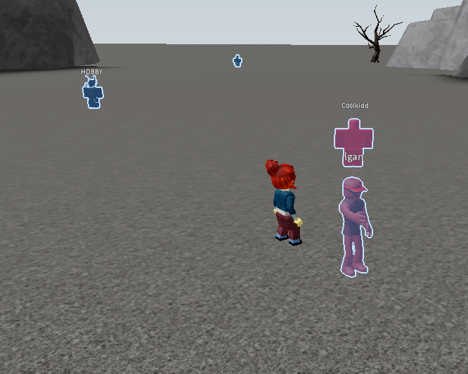

# Roblox Engine Chams

Character fills and outlines drawn by Roblox itself.



## Why I made this

A lot of people were trying to sell this, so I made my own version and decided to share it. Here is the implementation and the offsets, ready to add to your own project.

## What's the difference between engine chams and overlay chams?

| | Engine chams | Overlay chams |
| --- | --- | --- |
| Drawing | Roblox draws the effect using its native highlight passes. | Your overlay draws the effect over the game. |
| Shape | Uses the character geometry already rendered by Roblox. | Depends on the overlay: boxes, projected shapes, or rebuilt models. |
| Capture | Part of the game image. | Depends on the overlay and capture method. |

Engine chams are not streamproof. Hiding an overlay from capture does not hide these highlights.

## What's included

Only the chams module. No full application, menu, overlay, or prebuilt EXE.

- [chams.cpp](chams/chams.cpp) / [chams.h](chams/chams.h) - character lookup, highlight setup, updates, and cleanup.
- [layout.h](chams/layout.h) - all required offsets and client build checks.
- [memory.h](chams/memory.h) - a small interface for reading and writing memory.
- [process_memory.h](chams/process_memory.h) - the included Windows process memory adapter.

## How to add it

1. Copy the `chams/` folder into your project.
2. Add `chams/chams.cpp` to the files your project compiles. Headers alone are not enough.
3. Build for **x64** with **C++20 or newer** and a Windows SDK. No ImGui or DirectX dependency is needed.
4. Pass in an open Roblox process handle and the base address of `RobloxPlayerBeta.exe` from your existing attach code.

The handle needs `PROCESS_VM_READ | PROCESS_VM_WRITE | PROCESS_VM_OPERATION`. The example below also needs `SYNCHRONIZE` to check whether the process has exited.

Call `Update()` regularly. This example does it every 50 ms on a worker thread:

```cpp
#include "chams/chams.h"
#include "chams/process_memory.h"

#include <chrono>
#include <memory>
#include <stop_token>
#include <thread>

void RunChams(std::stop_token g_stop, HANDLE g_process, std::uint64_t g_module_base)
{
    auto g_memory = std::make_shared<chams::ProcessMemory>(g_process);
    auto g_chams = std::make_unique<chams::Engine>(g_memory, g_module_base);
    chams::Settings g_settings;

    while (!g_stop.stop_requested() && WaitForSingleObject(g_process, 0) == WAIT_TIMEOUT)
    {
        g_chams->Update(g_settings);
        std::this_thread::sleep_for(std::chrono::milliseconds(50));
    }

    g_chams->Stop();
}
```

After your existing attach code has set `g_process` and `g_module_base`, start the worker and keep it alive for the session:

```cpp
std::jthread g_worker(RunChams, g_process, g_module_base);
```

Before closing your process handle or attaching to a different client, stop and join it:

```cpp
g_worker.request_stop();
g_worker.join();
```

Keep the original handle valid until the worker has joined. Create a new engine for a new process. The module does not find the process or module base for you.

## Settings

Chams are enabled by default, with blue fills, light outlines, and through-wall rendering. The local player is skipped, and existing character highlight IDs are left alone.

Change these fields in your `chams::Settings` object:

- `g_enabled` - turn the effect on or off.
- `g_through_walls` - show through walls or use depth testing.
- `g_fill` / `g_outline` - red, green, blue, and opacity, each from 0 to 1.

Keep calling `Update()` after changing settings. Setting `g_enabled` to false removes the effect on the next update. Do not change settings from another thread without a lock or a safe handoff. Use one engine instance per client, and call its methods from one thread.

For status, use `GetStatus()` with `Engine::Describe()`. `GetPlayerCount()` and `GetEntityCount()` show how many targets have highlight IDs applied.

## Offsets and compatibility

Tested client: `version-cec3ad5889b447cf`.

All offsets are in [chams/layout.h](chams/layout.h). Module-relative addresses are added to the Roblox module base. Member offsets are added to the object they belong to.

Roblox updates can change these values. Recheck the layouts and build checks together; do not just disable the checks to force a new version to run.

## Notes
If you want anything released sned me a message.
